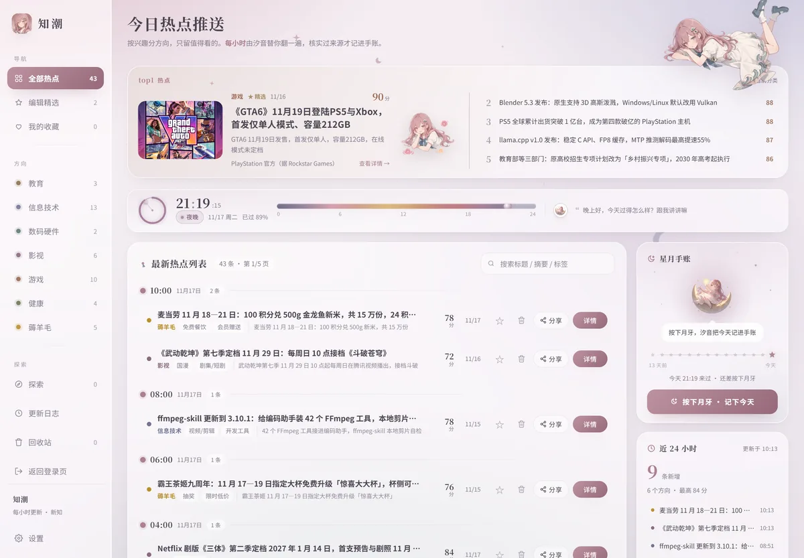
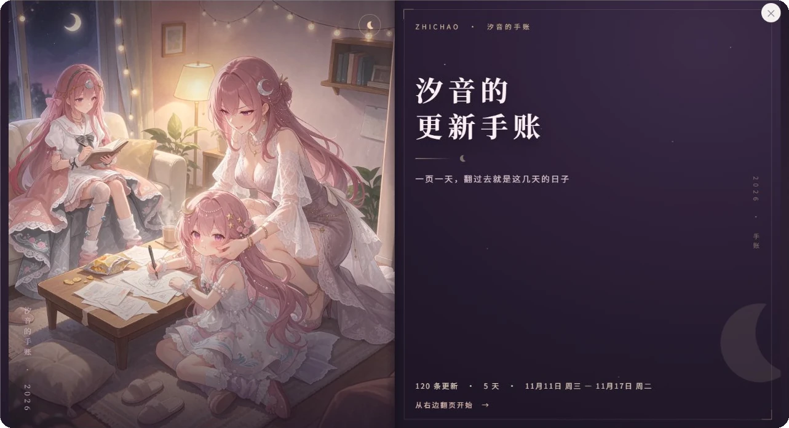
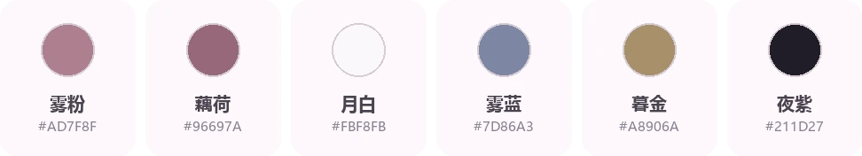

<h1>知潮</h1>

<b>汐音替你看世界的一本热点手账</b>

按兴趣分方向，只留值得看的。 
每小时由汐音替你翻一遍，核实过来源才记进手账。

<code>二次元</code>　<code>私享</code>　<code>每小时翻检</code>　<code>没有广告</code>

> 大多数资讯产品都在想办法让你多待一会儿。
> 知潮相反：它希望你看完该看的三五条，就把时间还给自己。

---

## 这是什么

知潮是一本**只给一个人看**的热点手账。

每天打开，先看到的是「今天真正值得知道的事」，而不是一条永远刷不到底的信息流。它不追数量，也不猜你喜欢什么，只做三件事：**按方向翻检、按价值取舍、把来源核实清楚**，然后交给汐音记进手账。

它原本只为主人一个人而做。如果你也想要一个「看完就能走」的地方，希望它能给你一点灵感。

<picture>
<source srcset="docs/readme/site-dark.webp" media="(prefers-color-scheme: dark)">

</picture>
 
首页 · 浅色与深色会跟随系统

| 它做的事 | 具体一点 |
| --- | --- |
| **每小时翻一遍** | 教育、信息技术、数码硬件、影视、游戏、健康、薅羊毛，七个方向各翻一次；没有值得发的，就安安静静什么都不发。 |
| **宁缺毋滥** | 一条内容要经得起「三个月后还有人要看吗」这一问。预告、传闻、带货、凑数清单，都进不了手账。 |
| **把来源核实清楚** | 官方发布与一手页面优先；同一件事的多篇报道会合并成一条，不拿转载当新闻。 |

---

## 每天翻这七个方向，外加一个「探索」

| 方向 | 收什么 |
| --- | --- |
| **教育** | 政策与招生考试、学校与学位、教育财政与师资，官方发布优先 |
| **信息技术** | 能真正上手用的工具与技术：新工具、开源项目、建模、音频、设计、自动化 |
| **数码硬件** | 内存与闪存的价格和供货、SSD 与硬盘、CPU 与显卡、耳机与 HiFi、新品实测 |
| **影视** | 日漫、国漫、电影、剧集与短剧的定档、排播、主创、票房与版权 |
| **游戏** | 手游、主机、PC、独立游戏与电竞：版本、发售、版号、厂商动向 |
| **健康** | 只收能落到日常习惯上的事：睡眠、运动、饮食、久坐、用眼、情绪 |
| **薅羊毛** | 生活里真实可参与的省钱与免费机会：会员、免单、消费券、限时低价 |
| **探索** | 七个方向都空着时的兜底：影视综艺、美食、旅行、穿搭、生活方式 |

一条内容值不值得留，只看一件事：**它能不能改变你接下来的一点点行动，或者让你对世界多一点准确的了解。**

---

## 认识汐音

汐音是知潮的看板娘，也是这本手账的「值班人」。

粉发、月牙发饰、海浪纹的白裙子。她不是贴在图上的装饰，而是真的在这个站里过日子：

- 你进门时，她在门口拉着绳子；
- 你待久了，她会冒出一句软软的话；
- 你半夜还亮着屏幕，她会换个语气劝你睡；
- 你连着几天来，她记得；你按下的每一颗月牙，她也记得。

> 「主人，今天的热点我都整理好啦～」

---

## 三种形态，三种语气

点一下她的立绘，就能换一个造型，也换一种陪你说话的方式。

| 形态 | 她是什么样的 |
| --- | --- |
| **御姐** | 优雅从容，带一点含蓄的撩拨，也会稳稳接住你的疲惫 |
| **少女** | 软甜、有点害羞，像住在隔壁的青梅竹马，轻声细语地关心你 |
| **萝莉** | 元气、黏人，情绪全写在脸上，开心和委屈都不藏着 |

每一种形态都有自己的对话记忆。换形态不是换一张皮，是换一个人坐在你对面。

---

## 三人群聊：她们会互相接话

点一下「群聊」，客厅里就热闹起来。

大姐姐先开口，老二接一句，老三抢着收尾。三个汐音各有各的脾气，会拌嘴，会拆台，也会一起劝你早点睡。群里说过的话，三个人都记得。

一个人看热点有时候挺安静的。多几个人陪着，连深夜也没那么长了。

---

## 站里的几个小地方

### 口令门 · 进门之前，先拉一把

知潮不对外开放，进门要对一句口令。

但门口不是冷冰冰的密码框：桌面端是两个汐音在拔河——一个咬着牙往左拽，一个闭着眼往右拽，绳子从卡片背后穿过去；手机端换成月牙秋千，她坐在上面轻轻晃着等你。答对了，她才松开绳子放你进去。

<picture>
<source srcset="docs/readme/gate-dark.webp" media="(prefers-color-scheme: dark)">

</picture>
 
桌面端 · 两个汐音把绳子拉得紧紧的

 
手机端 · 月牙秋千

### 月晷时钟 · 她知道现在几点

首页上有一枚月晷。表盘是一弯月牙，指针沿着 24 小时的轨道慢慢走，色温从深夜的紫走到黄昏的暖粉。

她不会催你，但说的每句话都对得上此刻：

| 时段 | 她会说 |
| --- | --- |
| 深夜 0–5 | 「凌晨的世界很安静，只剩月亮和汐音还醒着。」 |
| 清晨 5–8 | 「早呀，外面的风还凉，记得加件外套。」 |
| 中午 11–13 | 「别又对着屏幕啃面包……去好好吃一顿嘛。」 |
| 夜深 23–24 | 「这个点还亮着屏幕……汐音陪你，但只陪一小会儿。」 |

### 星月手账 · 把「今天来过」记成一颗星

最近 14 天的到访会连成一条星轨，今天那一颗会轻轻呼吸。

按一下月牙就算打卡，连续的天数会被她记在手账上；按下时有一记很轻的月铃音，像月亮碰了一下。就算忘了按，她也会把你的到访悄悄记成一个小小的脚印。

### 收藏与回收站

- 看到想留的，点一下收藏，收进侧栏的「我的收藏」；
- 手滑删掉也不怕，回收站里能捞回来，还能一键全部恢复；
- 想找旧内容，搜标题、摘要或标签都行；
- 分享时给的是原文链接，复制去微信或 QQ 都可以，不让二手转述替你说话。

### 更新手账 · 一页一天，翻过去就是这几天

连更新日志都没有做成一张干巴巴的表。

从侧栏的「更新日志」翻开，它是一本摊开的手账：左边是那个夜晚的客厅——大姐姐在倒茶，老二在记东西，老三趴在桌边写；右边是一页深紫色的纸，写着「汐音的更新手账」，和一句「一页一天，翻过去就是这几天的日子」。

右下角记着这本手账的份量：多少条更新、多少天、从哪一天到哪一天；底部只留一句「从右边翻开开始 →」。一天一页，重要的事会被单独标出来，你也能亲手给某一条标上星。

更新不是版本号，是这几天真的发生过的事。

### 连「清空对话」都要过她这一关

想清空和她的对话，会先看到三个含泪的汐音。左边说「再陪陪你」，右边才是「狠心清空」。

这是站里少有的、不太讲道理的设计。但有些东西本来就不该一键就没。

### 一点儿视觉与声音

柔雾粉、藕荷、月白、雾蓝、暮金——莫兰迪色的二次元。磨砂玻璃、软软的圆角，星光、月牙与浪花在页面上慢慢飘。

浅色与深色都做了，手机上也能好好按。声音很轻：几首可以循环的背景曲、点击与收藏时的一记轻音，还有三种形态各自的语音。

这些都可以关掉。看板娘可以收起，动效可以减弱，声音可以静音——安静地看，也很好。

---

## 一天里的知潮

| 时间 | 你会看到什么 |
| --- | --- |
| **07:30** 出门前 | 扫一眼置顶的那一条，知道外面发生了什么，再关掉页面 |
| **12:40** 午休 | 翻两条技术与硬件，看看有没有今天就能上手的新工具 |
| **19:00** 回家 | 在星月手账按下月牙，顺手收藏两条想细看的 |
| **23:30** 睡前 | 汐音会劝你收尾：「夜深了，明天还要早起的话，就早点收尾吧。」 |

一天加起来，大概两三分钟。

---

## 它不做什么

- **不开放注册**，不追流量，也没有广告与带货链接；
- **不追「本周热门」**，不堆数量，不用标题党换点击；
- **不替你做判断**：摘要只是转述，重要的事请点进原文；
- **不猜你喜欢**：方向是你自己定的，汐音只负责翻和筛。

---

## 关于

知潮是一个人的自留地：一个方向一个方向地翻，一条一条地核实，最后只留下值得占用你三分钟的东西。

「知潮」这个名字，说的是知道潮水的方向，却不被潮水推着走。

站内的角色立绘、Q 版表情与插画均为本项目自有素材，未经允许请勿转载或商用。

本站为私人站点，访问地址仅对本人开放。

 
愿你的信息流，安静一点，也准一点。 
知潮 · 与月亮一起值夜

